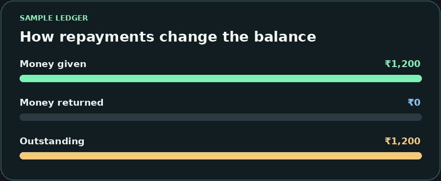
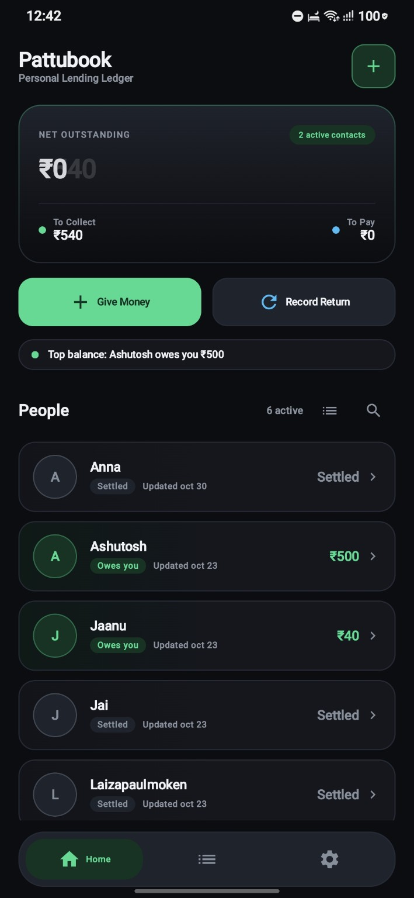
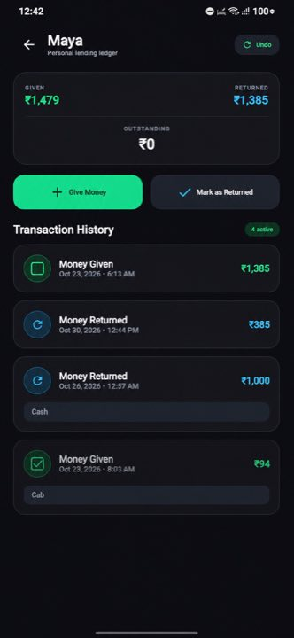
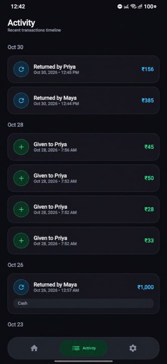
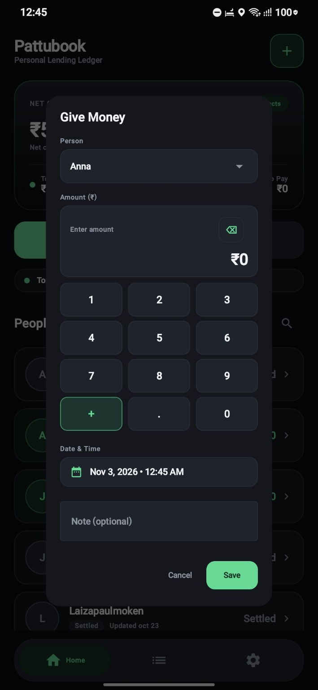
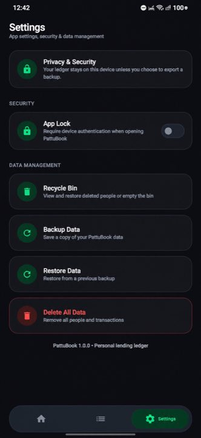
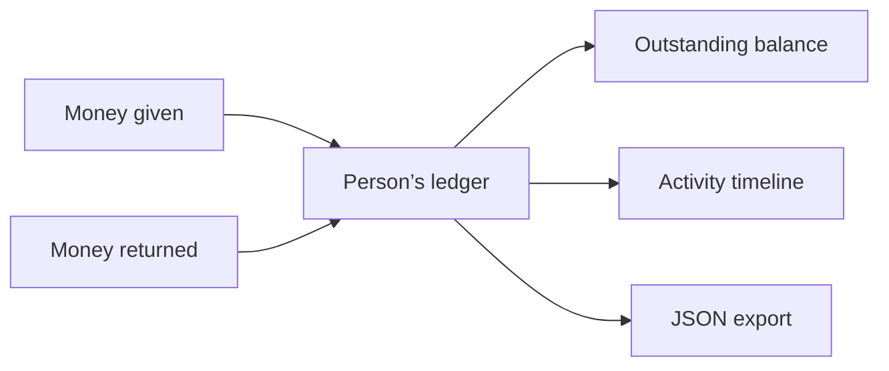

<p align="center">
  
</p>

<h1 align="center">PattuBook</h1>

<p align="center">Record what you lend, log what comes back, and see what’s still outstanding for each person.</p>

<p align="center">
  <strong><a href="https://github.com/sathwikcherott/pattubook/releases">↓ Download APK</a></strong>
  &nbsp;·&nbsp; <a href="#screenshots">Screenshots</a>
  &nbsp;·&nbsp; <a href="#build-from-source">Build from source</a>
</p>

<p align="center">
  <kbd>Android 10+</kbd> &nbsp; <kbd>Kotlin</kbd> &nbsp; <kbd>Jetpack Compose</kbd> &nbsp; <kbd>Room</kbd>
</p>

## Features

| | What you can do |
| --- | --- |
| ↗ **Record a loan** | Pick a person, enter the amount, and add a date and optional note. |
| ↙ **Log a repayment** | Record money returned and see the outstanding balance for that person. |
| ▤ **Review activity** | Browse the activity timeline or open a person’s ledger for their transaction history. |
| ↶ **Correct mistakes** | Edit a transaction or recover deleted items from the Recycle Bin. |
| ◈ **Personalize the ledger** | Hide people from the overview and enable optional device authentication. The schema 7 branch also supports profile photos with pan and zoom cropping. |
| ↻ **Back up the ledger** | Export a local JSON copy of people and transactions and restore it when needed. |

## The balance in motion

<p align="center">
  
</p>

*Illustrative data. In this example, ₹1,200 given minus ₹660 returned leaves ₹540 outstanding.*

## Screenshots

<table>
  <tr>
    <td align="center"><br><strong>Home overview</strong></td>
    <td align="center"><br><strong>Person ledger</strong></td>
    <td align="center"><br><strong>Activity timeline</strong></td>
  </tr>
</table>

<details>
  <summary>See the entry form and settings</summary>
  <br>
  <table>
    <tr>
      <td align="center"><br><strong>Give Money</strong></td>
      <td align="center"><br><strong>Settings</strong></td>
    </tr>
  </table>
</details>

## How the ledger works



The ledger lives in a local Room database. To take a copy with you, use **Settings → Backup Data**. Restoring a JSON backup replaces the current ledger after confirmation. JSON exports contain ledger data and omit the profile photo files.

## Install on Android

Download the APK under **Assets** on the [Releases page](https://github.com/sathwikcherott/pattubook/releases). PattuBook requires **Android 10 or newer**.

If an older install uses a different signing key, Android will reject an in-place update. Export a fresh backup and verify that it restores on a spare device or emulator before removing the working installation.

## Build from source

For the schema 7 build with profile photo cropping, use [`codex/pattubook-data-safety`](https://github.com/sathwikcherott/pattubook/tree/codex/pattubook-data-safety). Open the project in Android Studio, install the **Android SDK 36.1** platform if prompted, and run the `app` configuration.

```bash
git clone --branch codex/pattubook-data-safety https://github.com/sathwikcherott/pattubook.git
cd pattubook
./gradlew testDebugUnitTest assembleDebug
```

The debug APK is generated at `app/build/outputs/apk/debug/app-debug.apk`.

Found a bug? [Open an issue](https://github.com/sathwikcherott/pattubook/issues/new) with your app version, Android version, and steps to reproduce it.
